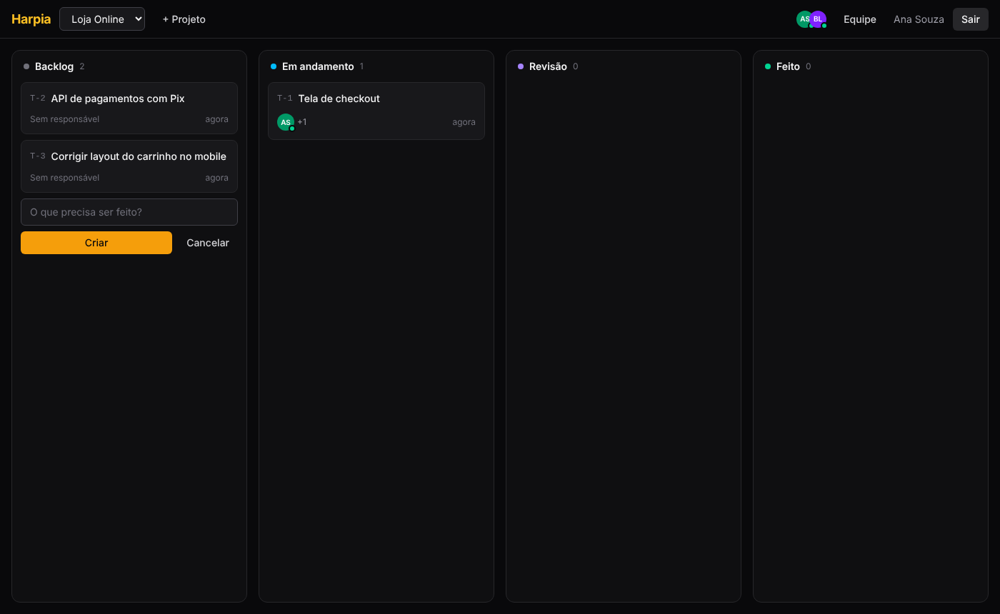
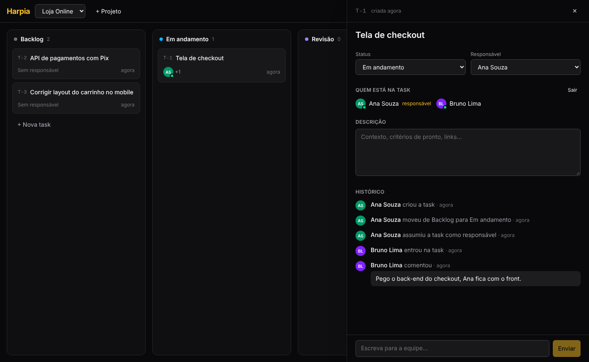
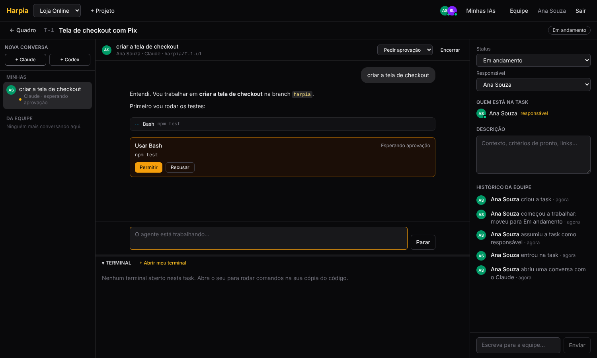
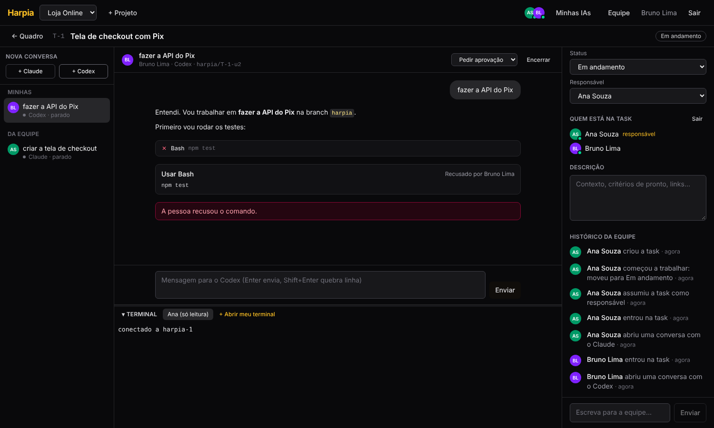
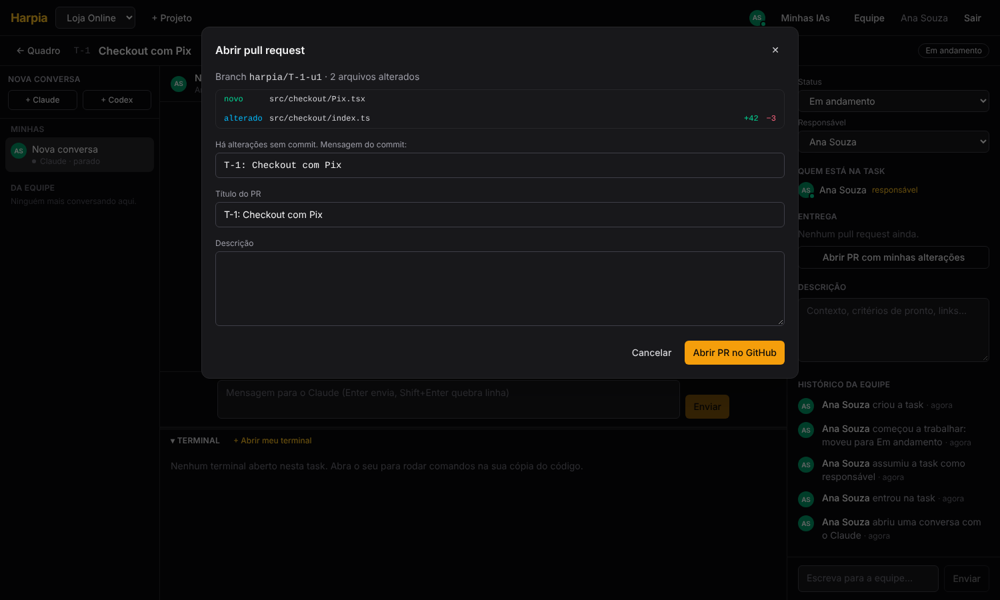
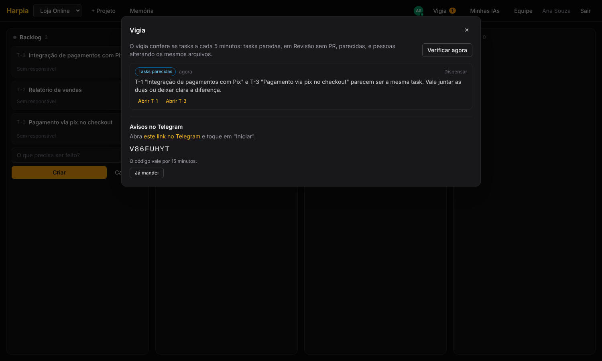

# Harpia

Workspace para a equipe trabalhar junta em tasks, cada pessoa com o próprio agente de IA
(Claude Code, Codex), rodando 24h numa VPS.

**Situação:** fases 1, 3, 4 (parte sem IA) e 5 prontas.

- Login com convites, projetos ligados a repositórios git e quadro de tasks em tempo real
  (Backlog, Em andamento, Revisão, Feito), com participantes, histórico completo e comentários.
- Dentro de cada task, cada pessoa conversa com o próprio Claude ou Codex num chat (como no
  Orca), na própria cópia do código e na própria branch. O agente pede aprovação antes de agir,
  e a equipe acompanha todas as conversas ao vivo. Embaixo do chat fica o terminal de cada um.
- Cada pessoa conecta a própria assinatura do Claude e do Codex em **Minhas IAs**.
- Na seção **Entrega**, cada pessoa abre o PR com as próprias alterações. Quando os PRs da task
  têm merge, ela vai sozinha para "Feito".
- O **Vigia** avisa tasks paradas, em Revisão sem PR, parecidas e pessoas mexendo nos mesmos
  arquivos, na tela e no Telegram. A **Memória** do projeto entra em toda conversa com os agentes.

O plano das próximas fases está em [docs/ARQUITETURA.md](docs/ARQUITETURA.md).








## Rodar no seu computador

Precisa de Node.js 22.18 ou mais novo.

```bash
npm install
npm run dev:server   # terminal 1: servidor em http://127.0.0.1:7420
npm run dev:web      # terminal 2: interface em http://localhost:5173
```

Os dados de desenvolvimento ficam em `~/.harpia`. Para começar do zero, apague essa pasta.

## Comandos

| Comando | O que faz |
|---|---|
| `npm test` | testes do servidor |
| `npm run typecheck` | checagem de tipos do servidor e da interface |
| `npm run build` | compila a interface em `web/dist` |
| `npm start` | servidor de produção (serve também a interface compilada) |
| `npm run check` | tudo acima, antes de enviar mudanças |

## Colocar no servidor

- **Coolify (o que a equipe usa):** [docs/COOLIFY.md](docs/COOLIFY.md).
- Sem Coolify, direto numa VPS com systemd e Tailscale: [docs/VPS.md](docs/VPS.md).
